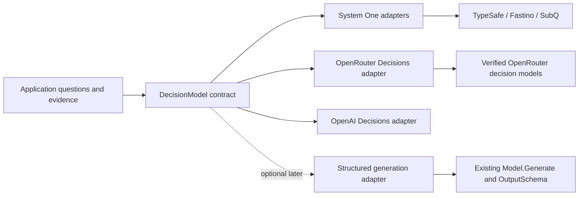

# A common decision contract for Lebro

Research snapshot: 20 October 2026, Africa/Nairobi. This is a design proposal, not an implemented API. Sources are official documentation, official SDK schemas inspected during research, and unauthenticated model-catalog GETs. No paid inference or account-specific availability checks were performed.

## Recommendation

Keep `DecisionModel.Decide` as the runtime boundary. The common abstraction is **shared evidence and named independent questions producing typed judgments**, with predicate, choice, and ordered score as the initial primitives. Provider JSON belongs in adapters. The existing runtime is already close to this contract; expanding the configuration of `NewSystemOne` alone will not cover the differences.

Implement native decision protocols first: the existing System One adapters, OpenRouter Decisions, and direct OpenAI Decisions. Ordinary chat models with structured output can be a separate, explicitly selected adapter later. JSON schema support establishes output shape; it does not establish that generated probability numbers have the same statistical meaning as native decision probabilities.

## What OpenRouter actually offers

OpenRouter documents `POST /api/alpha/decisions` using `state`, a question map, and a keyed answer map. Its TypeSafe compatibility endpoint remains `POST /api/v1/systemone`. These are separate from Chat Completions. [Decisions API](https://openrouter.ai/docs/api/api-reference/alphadecisions/submit-a-decisions-request), [TypeSafe SDK compatibility](https://openrouter.ai/docs/guides/community/typesafe-sdk).

An unauthenticated GET of [the Decisions-filtered catalog](https://openrouter.ai/api/v1/models?output_modalities=decisions) returned 27 entries, including aliases and free variants. Selected exact IDs and advertised input modalities were:

| Model ID | Advertised input | Catalog context length |
| --- | --- | ---: |
| `typesafe/jev-1.14` | text, image | 262,144 |
| `typesafe/jev-1.13` | text, image | 262,144 |
| `openai/gpt-6-luna-decisions` | text, image | 1,050,000 |
| `microsoft/microsoft-decision-1` | text | 32,768 |
| `perplexity/pplx-decider-v1.2` | text, image | 262,144 |
| `cloudflare/clef-omni` | text, image, audio, video | 65,536 |
| `inception/mercury-decide` | text, image | 65,536 |
| `liquid/d1` | text, image | 65,536 |
| `scaledown/classify-1` | text, image, file | 1,000,000 |

These are discovery results, not verified Lebro support. In particular, a listed file modality does not specify a portable file protocol. All 27 entries had empty `supported_parameters` arrays: use `architecture.output_modalities` to discover decision models, then obtain question support, uncertainty fields, limits, and encoding from a verified adapter profile. Some other entries have `context_length: 0`; treat that as unknown until clarified, not zero usable capacity or unlimited capacity.

Even this shared endpoint has model-specific state envelopes. ScaleDown documents `state.text` for text and `state.document` plus `state.document_mime_type` for a document; its own API overview says only those state fields are read. A model profile must include any such input codec; changing a model ID alone is not enough to advertise transparent substitution. OpenRouter also warns about a special Respan Span-01 shape, but its model example uses a string; that inconsistency needs clarification before binding a verified profile. [ScaleDown input contract](https://docs.scaledown.ai/api-reference/decisions-overview), [OpenRouter ScaleDown cookbook](https://openrouter.ai/docs/cookbook/building-agents/detect-agent-loops-with-scaledown), [cross-model guidance](https://openrouter.ai/docs/guides/community/jev).

The gateway is also part of a model's identity. The sampled `~typesafe/jev-latest` alias targeted Jev 1.14, while [TypeSafe's direct model documentation](https://docs.typesafe.ai/models) described its own `jev-latest` as stable Jev 1.13. Do not assume aliases or capability limits match across routes.

For optional structured-generation coverage, the ordinary [Models API](https://openrouter.ai/api/v1/models) listed `openai/gpt-6-luna`, `google/gemini-3.1-pro-preview`, `anthropic/claude-sonnet-4.6`, and `qwen/qwen3.5-397b-a17b` with structured-output parameters. Those are a different execution path. Endpoint support varies; OpenRouter recommends `require_parameters: true`, and its documentation qualifies schema enforcement by provider. Always validate outputs locally. [Structured outputs](https://openrouter.ai/docs/guides/features/structured-outputs).

## The semantic intersection

| Concern | Jev / SubQ | Fastino GLiDE | Direct OpenAI Decisions | Lebro contract |
| --- | --- | --- | --- | --- |
| Binary judgment | `noul` probability | `noul` probability | `predicate.probability` | Probability that a stated condition holds |
| Choice identity | String option keys | String option keys | String or boolean values | Stable caller-owned option IDs |
| Score scale | Ordered zero-based levels | Ordered zero-based levels | Ordered zero-based levels | Ordered level descriptions |
| Weighted score | `score` | `expected_level` | `score` | Optional expected level, separate from winner |
| Winning score level | No dedicated winner | Integer `score` | No dedicated winner | Optional selected level |
| Answer association | Keyed map | Keyed map | Ordered array with names | Answers keyed by unique request question IDs |
| Refusal | No documented variant in these direct schemas | No documented variant | Any question can refuse independently | First-class refusal answer |

Sources: [Jev API](https://docs.typesafe.ai/api), [SubQ Decisions](https://docs.subq.ai/endpoints/decisions-api/), [GLiDE score](https://docs.fastino.ai/concepts/glide-score), [OpenAI Decisions](https://developers.openai.com/api/reference/resources/decisions/methods/create).

String IDs are a sufficient portable choice core. An application can map an option ID to a boolean, enum, tool, or business object locally. An adapter using OpenAI can submit the string IDs directly; exposing every provider's native option-value union is unnecessary for this first slice. Likewise, keep zero-based score levels: caller-owned nonlinear scales can be calculated from a distribution afterward.

Maps need not be replaced in the public API to support OpenAI's arrays. Sort question IDs and option IDs when translating, preserve the mapping, send unique names, and reject duplicate, unknown, missing, or incorrectly typed answers. A wire ordering constraint is an adapter responsibility.

## Confidence requires explicit semantics

The same probability distribution can produce different native confidence numbers:

| Provider and answer | Documented confidence meaning |
| --- | --- |
| Jev Choice | Top probability normalized against a uniform baseline |
| Jev Score | Normalized expected distance from the modal level |
| GLiDE Choice and Score | Difference between the top two probabilities |
| GLiDE Noul | Absolute distance from 0.5, scaled to 0–1 |
| OpenAI / SubQ | Confidence exposed; no formula established by the sources reviewed |

[Jev confidence](https://docs.typesafe.ai/confidence), [GLiDE Choice](https://docs.fastino.ai/concepts/glide-choice), [GLiDE Noul](https://docs.fastino.ai/concepts/glide-noul), [OpenAI interpretation](https://developers.openai.com/api/docs/guides/decisions), [SubQ response](https://docs.subq.ai/endpoints/decisions-api/).

For example, probabilities `{a: 0.8, b: 0.1, c: 0.1}` imply Jev Choice confidence 0.70 and GLiDE confidence 0.70 by coincidence; changing them to `{a: 0.8, b: 0.2, c: 0}` leaves Jev at 0.70 but makes GLiDE 0.60. A shared `MinimumConfidence` threshold is therefore not automatically portable.

Preserve the reported value, attach a metric identifier per question kind, and record the resolved model and upstream provider. Unknown metric is an explicit state. If callers want a common statistic, provide separate helpers such as `TopProbability`, `TopTwoMargin`, and `ExpectedIndexFromDistribution`. Mark computed quantities as derived. Neither a shared formula nor a native endpoint proves calibration on the application's data.

Do not repurpose native confidence to mean probability of correctness. Threshold policies should be evaluated for the model, route, metric, and use case they govern.

## Proposed runtime changes

The following is an illustrative shape; field names and versioning need an implementation decision:

```text
DecisionModel.Decide(context, DecisionRequest) -> DecisionResponse, error

DecisionRequest:
  State       JSONValue
  Images      []DecisionImage
  Questions   map[QuestionID]Question

Question:
  Predicate / Noul { instructions, optional true/false criteria }
  Choice          { instructions, options keyed by stable IDs }
  Score           { instructions, ordered level descriptions }

Answer:
  NoulAnswer | ChoiceAnswer | ScoreAnswer | RefusalAnswer

DecisionResponse:
  Answers          map[QuestionID]Answer
  AnswerMetadata   map[QuestionID]{ uncertainty sources, confidence metric }
  Provider         gateway/adapter identity
  UpstreamProvider optional actual serving provider
  RequestedModel   original selection
  Model            resolved model identity
  Usage, Accounting, RequestID, Duration, Attempts
```

1. **Add refusal as an answer.** Extend the closed answer union with `RefusalAnswer`; preserve successful sibling answers. A refusal is distinct from false, low probability, a missing field, or a transport failure. Keep its reason optional because OpenAI's question refusal need not supply one. Existing gates must fail closed on an unexpected/refused answer. The OpenRouter SDK schema inspected did not explicitly describe refusal even though direct OpenAI does; gateway propagation requires a contract test before being advertised.

2. **Keep the existing binary semantics.** A `PredicateQuestion` / `PredicateAnswer` alias can make naming neutral without inventing a second meaning or removing `NoulQuestion`. OpenAI's `predicate` maps to the same probability-of-true concept.

3. **Make uncertainty metadata per answer kind.** Keep optional confidence and distributions. Describe whether each is required, optional, or unavailable for that model and kind. Reject incomplete supplied distributions; a missing required distribution is malformed. Do not interpret an absent distribution as an all-zero distribution. Add a new generated-source marker only if a structured-generation adapter is actually introduced.

   OpenRouter's current [score answer schema](https://github.com/OpenRouterTeam/typescript-sdk/blob/main/src/models/decisionsscoreanswer.ts) explicitly makes distributions and confidence optional. Its [Noul answer schema](https://github.com/OpenRouterTeam/typescript-sdk/blob/main/src/models/decisionsnoulanswer.ts) contains a probability and type, with no confidence field. Do not inherit Fastino's direct Noul-confidence capability when using a different route.

4. **Preserve score facts and expose derivations separately.** Keep `ExpectedLevel` and `SelectedLevel`. Require explicit score mapping for generic System One scoring profiles. Where a distribution exists, validate its coverage, finite probabilities, and approximate normalization, with provider-specific rounding tolerances. A helper can compute an expected index without guessing a wire field. Preserve the native reported score and its provenance; never silently overwrite it with the helper's result.

5. **Bind capabilities to a route and selected model.** The current adapter-wide `Capabilities()` is insufficient when `request.Model` overrides the default. Resolve a verified profile for that model before sending, or reject an override outside the bound profile. Track input modalities, structured instructions, per-kind uncertainty, refusal support, limits, and input-preservation behavior. Catalog metadata helps discovery; it is not proof of all these properties. Unknown limits stay unknown.

6. **Preserve identity and accounting.** Add upstream identity and reuse the existing accounting concepts instead of creating another cost format. OpenRouter's response carries a generation ID, upstream provider, and cost; tokens alone lose relevant execution information. Record known routed attempts if available, and do not claim the gateway exposes an attempt count it does not report.

7. **Keep caller policy outside the result.** A judgment never becomes an authorization. Keep the existing approval, cancellation, tenant credential, retention, and retry boundaries. A gateway's routing policy must be explicit: an upstream fallback can change data handling and confidence semantics even when the model ID stays constant. [OpenRouter provider routing](https://openrouter.ai/docs/guides/routing/provider-selection).

## Input and image translation

Keep caller-supplied raw image bytes as the portable input for the first slice. Adapters can encode them as data URLs without fetching remote images or introducing upload ownership. The wire shape must be selected by protocol and route, not only by the underlying model brand.

| Route | Adapter translation |
| --- | --- |
| Direct SubQ | Top-level `images` with media type and plain base64 |
| Direct Fastino | Image parts in a state array; use data URLs from caller bytes |
| Direct TypeSafe | Assets plus references and experimental opt-in header |
| OpenRouter Decisions | Data-URL `image_url` parts in the state array |
| Direct OpenAI Decisions | `input_image` parts in input messages |

[SubQ images](https://docs.subq.ai/endpoints/decisions-api/), [Fastino state](https://docs.fastino.ai/inference/systemone), [TypeSafe images](https://docs.typesafe.ai/images), [OpenRouter media formats](https://openrouter.ai/docs/guides/community/multimodal-decisions), [OpenAI inputs](https://developers.openai.com/api/reference/resources/decisions/methods/create).

An important counterexample to configuration-only portability: OpenRouter rejects a top-level `images` field, and its Decisions image URL must be a base64 data URL. Repointing the SubQ adapter at that endpoint is not sufficient. TypeSafe's direct assets protocol also differs from the gateway's media translation.

For OpenAI, structured state can be serialized explicitly to labeled JSON text, with instructions defining that representation. This is a documented adapter transformation, not a claim that native JSON-state processing is identical. Reject unsupported structured instructions unless a tested rendering policy is explicitly selected.

Keep initial portable media to shared state plus images. Question-local image references, Box, audio, video, files, and native conversation/tool history are optional extensions with separate capability tests. TypeSafe labels images and Box experimental; Box should not become a fourth required primitive.

Input preservation deserves a specific check. OpenRouter documents that Clef/Clef Flash read roughly the first 2,000 state text tokens and drop the remainder, and that unsupported audio/video may be treated as JSON text by other decision models. Lebro must not advertise full evidence processing merely because the catalog has a large context number. Select a verified route or reject inputs that cannot be preserved. The catalog and guide also differed on some advertised context and image-dimension limits, reinforcing the need for versioned profiles and live validation. [Multimodal limitations](https://openrouter.ai/docs/guides/community/multimodal-decisions).

## Adapter boundaries and implementation order



1. Extend the runtime answer contract and shared contract suite for refusal, answer association, uncertainty absence, score provenance, and model-profile selection. Keep existing types and maps; add aliases rather than requiring a naming migration.
2. Harden the existing System One profile constructor: explicit scoring fields and validated declared capabilities. Keep it a protocol-specific advanced constructor.
3. Add a named OpenRouter Decisions adapter using `/api/alpha/decisions`, with explicit provider routing and response metadata handling. Start with a small verified text-only profile set, then image-capable profiles. Discovery should expose unsupported/unknown models without claiming them as verified.
4. Add direct OpenAI Decisions translation and partial-refusal fixtures. Serialize structured state explicitly. Retain its distinct request and response codec even if it shares the HTTP transport.
5. Expand neutral image translation per route. Add more modalities only when an actual caller needs them and their contracts are verified.
6. Consider a structured-generation adapter separately. Reuse `ModelRequest.OutputSchema`; require explicit opt-in and local schema validation. A generated yes/no answer must not be converted into probability 0 or 1. The current required `NoulAnswer.ProbabilityYes` cannot represent a boolean-only judgment faithfully, so this expansion needs a deliberate result-contract decision rather than a fabricated probability.

The first implementation slice is complete when one unchanged caller request can run through the existing direct adapters, OpenRouter Decisions, and direct OpenAI Decisions, with equivalent question identity and score meanings, preserved refusals, explicit uncertainty semantics, and local rejection of unsupported input. This does not require equal judgments or identical confidence values across models.

## Verification required before advertising support

Use fixtures for protocol invariants and opt-in provider runs for capability evidence. Cover a reordered response, duplicated/missing names, a refusal alongside a valid answer, absent versus partial distributions, Fastino winner versus expectation, and wrong generic score mappings. Test route-specific image encodings and model overrides. Verify the resolved model, upstream identity, and accounting survive translation.

For live checks, include evidence placed near the end of a long input to detect material truncation, and media that the selected model truly interprets. Test uncertainty thresholds against labeled application examples; fixture correctness does not establish calibration or live endpoint availability. Record model versions and the exact route used.

Repository seams: `internal/runtime/decision.go`, `api_types.go`, `decisions/provider.go`, `decisions/systemone.go`, and `internal/testkit/decision.go`. Existing content types in `internal/runtime/content.go` and accounting in `internal/runtime/cost.go` should be assessed for reuse before adding parallel abstractions. No runtime implementation is included in this proposal.
